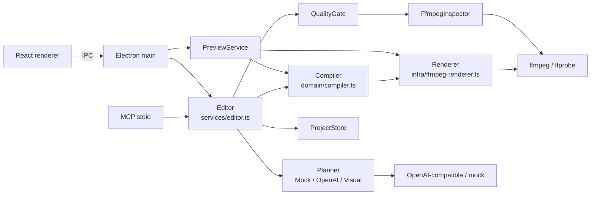

# Pimko 架构（当前实现）

> 更新：2026-10-29。本文描述现有代码，不是目标设计。产品意图与质量契约见 [intent.md](intent.md)，架构决策与权衡见 [剪辑架构设计](design/2026-10-29-editing-architecture.md)，执行进度见 [重建计划](plans/2026-10-29-editing-core-rebuild.md)。

## 运行时与入口

- Electron 33 + React 18 + TypeScript；electron-vite 构建；开发用 `npm run dev`，产物在 `out/`。
- 主进程 `src/main/index.ts`：注册 `pimko-media://`、加载 `.env`、装配 `Editor`、`PreviewService`、`FfmpegInspector`、`MockPlanner`/`OpenAiPlanner` 与 `VisualPlanner`、注册 IPC。
- preload `src/preload/index.ts` 暴露 `window.pimko`；契约在 `src/shared/api.ts`。
- renderer `src/renderer/src/App.tsx`：导入（支持多选）、对话、草稿/效果/成片预览、故事板片段、字幕与配乐。
- MCP stdio：`scripts/mcp.ts` 启动 `src/mcp/server.ts`；工具 `list_projects`、`create_draft`（`videoPath`/`videoPaths`）、`revise`、`undo`、`add_broll`、`set_bgm_volume`、`get_timeline`、`export`。

## 模块职责

| 目录 | 职责 |
|---|---|
| `src/domain/document.ts` | `EditDocument`（schemaVersion 2）、video/audio/overlay 轨、`VideoClip`/`AudioClip`、B-roll helper、字幕策略 |
| `src/domain/compiler.ts` | 纯函数 `compile(document, analysis)` → `CompiledTimeline`：输出时间、变速、转场重叠、overlay 轨、BGM、字幕投影、时长 |
| `src/domain/legacy.ts` | 旧 `Timeline` ↔ `EditDocument` 适配、`compileProject`、旧项目 normalize |
| `src/domain/edit-plan.ts` | 补丁 `EditPlan`/`EditOp`、`applyPlan`/`validatePlan`；非法计划整份拒绝 |
| `src/domain/baseline.ts` | 语音确定性预剪：转写段 + 静音压缩 → keep ops |
| `src/domain/visual.ts` / `visual-baseline.ts` | 镜头/黑帧/响度事实、内容类型初判、视觉 keep 计划 |
| `src/domain/quality.ts` | `QualityReport`/`QualityVerdict` 与检查汇总 |
| `src/domain/timeline.ts` | 旧扁平 `Timeline` 兼容视图；不再是新编辑真源 |
| `src/ports/` | `Prober`、`Transcriber`、`Planner`、`VisualAnalyzer`、`Inspector`、`Renderer`、`Store`、`SilenceAnalyzer`；旧 `EditingIntelligence` 仍保留 |
| `src/services/editor.ts` | 唯一命令层：createDraft/createDraftFromPaths/revise/undo/restore/export/setBgm/addBroll 等 |
| `src/services/preview.ts` | 编译后预览，按修订缓存、串行编码 |
| `src/services/quality-gate.ts` | 导出后质量闸门；fail 抛 `QualityError`，warn 允许交付 |
| `src/ports/quality-store.ts` / `src/infra/fs-quality-store.ts` | 按修订 id 持久化质量报告 |
| `src/infra/` | ffmpeg prober/renderer/inspector/scene analyzer/silence、fs store、OpenAI/OpenRouter 转写与 planner、mock planner、配置 |
| `src/main/`、`src/preload/`、`src/renderer/`、`src/mcp/` | Electron、UI、MCP 适配 |

## 核心模型

- `Project`：`assets`、`transcript`（兼容单素材）、可选 `transcripts`（多素材）、`silences`、`analysis`（contentKind/units/visual）、`document`、兼容 `timeline`、`settings`。
- `EditDocument` 是编辑状态唯一真源：视频/音频/叠加轨；`VideoClip` 有源区间、速度、role、anchor、transitionIn；BGM 是音频轨上的 `AudioClip`。
- `CompiledTimeline` 只由编译产生：`videoClips`、`audioClips`、`subtitles`（输出时间坐标）、`durationSec`、`warnings`；渲染器、预览、MCP 共用。
- `ProjectRevision` 追加不可变历史，`schemaVersion: 2`；旧修订缺省 schemaVersion，由 `legacy.ts` 只读迁移。
- `QualityReport`：修订/输出哈希、预计/实际时长、全局检查、每个切点检查与 verdict。

## 主要数据流

### 导入与建稿

1. `project:import` 支持单选/多选；或 `PIMKO_SELF_TEST_VIDEO`。
2. `Editor.createDraft`：probe → 转写（无音轨且配置了 visualPlanner 时降级视觉）→ 静音分析 → planner（speech baseline + mock/真实 ops；或 visual planner）→ `applyPlan` → `EditDocument` → `compile` → 新修订。
3. `Editor.createDraftFromPaths`：逐个 probe/转写，按输入顺序 append 到同一个 document；`Project.transcripts` 按 assetId 保存；多素材只做顺序硬切，跨素材语义修订有限。
4. 无音轨且没有任何 planner 时明确拒绝；网络/鉴权错误不会被当成"无音轨"吞掉。

### 对话修订

1. `Editor.revise` 读取最新修订，normalize document，编译当前视图。
2. `Planner.propose` 返回 `EditPlan` ops（keep/drop/trim/speed/reorder/transition/setBgm/setSubtitle）；真实模型由 `OpenAiPlanner` 调用 OpenAI 兼容接口，mock 由 `MockPlanner`。
3. `validatePlan`/`applyPlan` 本地校验：未知 ID、越界、速度、空结果整份拒绝；旧版保留。
4. 生成新修订，带 diff、note；计划本身当前未持久化（后续可加 `Revision.plan`）。

### 预览与导出

- 预览：`compileProject` → `Renderer.render({ compiled, assets, settings, mode: 'preview' })`；缓存键为 `sha256(projectId + revisionId)`，串行、同版去重。
- 导出：`compileProject` → 逐段处理（统一尺寸/帧率）+ 拼接 → 字幕最后叠加 → 可选 BGM 混音 → ffprobe 自检 → `FfmpegInspector` 质量闸门。
- `Editor.export` 返回 `{ outputPath, durationSec, quality }`；`fail` 抛 `QualityError`，保留成片供调试；`warn` 允许交付但报告明确警告。
- 质量检查：时长、分辨率、切词、黑帧、字幕时间；爆音为启发式，镜头切断/遮挡在 P4/P5 仍部分 skip。

## 外部依赖与配置

- 模型服务只有一个用户入口：一个 `providers.json` 文件（`active` + 1 个或多个 profile）；单模型就是只有一个 profile。每个 profile 可直接填写 `baseUrl`、`model`、`apiKey`，也兼容 `apiKeyEnv`；`protocol` 默认 `openai-chat`，需要 Responses API 时写 `openai-responses`；超时默认 300s，可在 profile 覆盖。
- `providers.json` 默认查找 `./providers.json` 或 `~/.config/pimko/providers.json`；`PIMKO_PROVIDERS_FILE` 只用于自定义路径，`PIMKO_LLM_PROFILE` 只用于临时覆盖 `active`。`npm run provider -- list|use` 切换。
- 转写默认跟随 LLM；如果 LLM 服务不支持 OpenAI 音频转写，再在 profile 的 `transcription` 里配独立 `baseUrl`/`model`/`apiKey`。所有模型设置、包括 key，都可以只放在这一个文件里。
- 旧版 `.env` 的 `PIMKO_LLM_*` 单服务变量只作为 CI/旧配置兼容回退，不是用户主路径；`anthropic` 原生协议仍未实现。
- ffmpeg 解析顺序：打包的 `resources/bin` → `ffmpeg-static` → 系统 PATH；ffprobe 仅打包目录或系统 PATH。开发环境需要系统 ffprobe。

## 内容类型

- `speech`：词级转写 + 静音/停顿；`baselinePlan` 先做确定性预剪，planner 只做语义补丁。
- `visual`：无语音时 `VisualPlanner` 用 `FfmpegSceneAnalyzer` 的 scdet/blackdetect/运动/响度，按镜头生成 keep 计划。
- `tutorial`：当前只能从"长镜头 + 低运动"低置信度初判；未做 OCR，文字可读性仍需人工。
- `mixed`：无法可靠判断时保持整段/混合策略，并在 note 中说明。

## 持久化

- 修订 JSON：`userData/projects/<projectId>/<revisionId>.json`；新修订含 `document`，兼容 `timeline` 作为派生视图。`PIMKO_DATA_DIR` 覆盖 MCP/无头路径。
- 分析事实随 `Project` 快照保存；多素材转写在 `transcripts`。
- 预览：`userData/previews/<hash>.mp4`；缩略图在 `userData/thumbnails/`。
- 质量报告写入 `userData/quality/<revisionId>.json`；导出回执返回，恢复项目后 UI 可重新读取。
- 旧项目按 `legacy.ts` 归一化；没有数据库、索引或删除操作。

## 验证

| 入口 | 作用 |
|---|---|
| `npm run typecheck` | 类型检查 |
| `npm run check:editing` | 93 项离线回归（document/compiler/planner/quality/visual/undo/preview） |
| `npm run check:fixtures` | 7 个合成素材的探测、静音、建稿、导出 |
| `npm run smoke` / `npm run smoke:mcp` | 端到端 / MCP 闭环 |
| `npm run test:ui` | Playwright + Electron mock E2E |
| `provider -- list/use` | 查看/切换 `providers.json` 的 active profile（不输出 key） |
| `npm run benchmark` / `benchmark:score` | P0 基准 harness（需 `PIMKO_BENCHMARK_DIR`；正式 B1–B5 素材未入库） |
| `npm run build` | electron-vite 构建 |

## 当前边界与已知风险

- **P5 限制**：多素材顺序合成与全屏 B-roll overlay 已实现（Editor/MCP/GUI/ffmpeg）；多条主视频轨仍只编译第一条，B-roll 音轨不混入，GUI 多素材草稿播放仍看第一段。
- **真实模型**：`OpenAiPlanner` 支持 chat/completions 与 Responses API，已实现 ops schema、重试与本地校验；真实 Groq 短链路和讯飞 `spark-x2.6`（main 10/10、6/6、4/4）已通过；免费档 TPM/长响应超时与成本仍是限制。
- **质量闸门**：切词/时长/黑帧/字幕有实现，爆音是启发式；时长默认容忍 200ms（逐段帧量化）；镜头切断与字幕遮挡仍部分 skip；黑帧检测阈值降到 0.15s 后 B3 mock 路径已 pass，真实 B3 未重跑。
- **基准**：P0 harness 已跑通 stand-in；正式 B1–B5 已跑（B4 是合成屏幕占位），人工评分尚未完成；B1 受 Groq TPM/JSON 错误影响，只应用了部分反馈。
- **UI**：质量报告以横幅显示 verdict/预期与实际时长/警告项，支持恢复项目后读取；多素材草稿播放仍指向第一段，需渲染预览查看合成结果。
- **兼容**：`timeline` 仍作为派生视图落盘，旧验收脚本依赖；P6 后应删除该第二视图。
- 既有缺陷：损坏修订 JSON 影响项目列表；快速双击/连点撤销可能产生重复修订；1fps 素材导出仍有风险。
