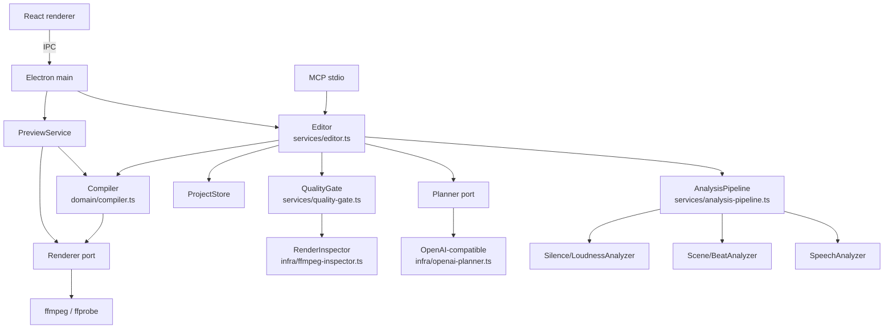
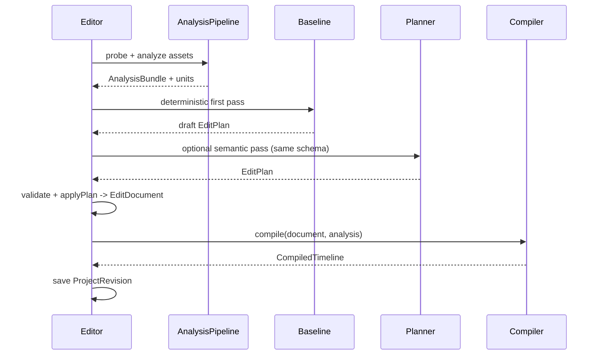

# Pimko 剪辑架构设计（提议）

> 状态：**已实现（有保留）**。依据 [产品意图](../intent.md) 与 [参考实现研究](../research/2026-10-29-reference-implementations.md)。实现进度与未完成的 B-roll/真实 API 验收见 [分阶段计划](../plans/2026-10-29-editing-core-rebuild.md#0-实现进度2026-10-29)。

## 1. 问题与约束

### 1.1 现有实现哪里不对

- `EditingIntelligence.draftTimeline/reviseTimeline` 直接返回完整 `Timeline`。LLM 同时决定语义、源时间边界、片段顺序、速度和转场，错误会整体传播。
- `Project.timeline` 是扁平 `clips` 数组，只有一条视频轨 + 一个 BGM；多素材/B-roll/叠加层会被迫改数据结构。
- 字幕是存储的 `SubtitleCue[]`，与转写、片段、变速的投影关系分散在多个地方。
- `FfmpegRenderer.render(project)` 直接读 `Project`，预览、MCP、导出没有共享一个编译产物。
- 渲染后只核对时长/分辨率，不检查切词、爆音、镜头切断、黑帧、字幕遮挡。
- 没有内容类型概念：口播、蒙太奇、教程共用一套分析器与质量规则。

### 1.2 必须保持

- Electron + React + TypeScript；本地 ffmpeg/ffprobe；密钥只在本地。
- `Editor` 是 GUI/MCP/其他客户端的唯一命令层；所有编辑进入 `ProjectRevision` 链，可撤销、可审计。
- 修订不可变；失败不覆盖旧版；空时间线不可导出。
- 现有 31 项离线回归与 fixtures/smoke 通过。
- 不复制 AGPL 代码；不把 openfilm 的 `film.html`/Chromium 渲染作为核心。

### 1.3 必须改变

- **文档成为唯一真源**：编辑状态是 `EditDocument`，不是 `Timeline`。
- **LLM 只能产出补丁操作**：引用稳定 `UnitId`/`ClipId`，不能直接吐时间线。
- **编译与渲染分离**：纯函数编译器产出 `CompiledTimeline`，渲染器只吃编译产物。
- **分析可插拔**：语音、镜头、节拍、黑帧、响度分别产出事实，按内容类型组合。
- **质量闸门看渲染输出**：切点检查与修复循环成为导出的一部分。

## 2. 调用者视角

### 2.1 Editor

```ts
const draft = await editor.createDraft(videoPath)
// draft.project.document 是 EditDocument；draft.plan 是生成它的补丁计划

const next = await editor.revise(draft.project.id, { text: '开头太拖，直接进正题' })
// next.document 与 next.diff 可直接给 UI/MCP

const result = await editor.export(next.project.id, outputPath)
// result: { outputPath, durationSec, quality: QualityReport }
```

`Editor` 内部负责：分析 → 确定性 first-pass → planner → 本地校验 → 应用补丁 → 编译 → 渲染 → 质量闸门。调用者不接触 ffmpeg、分析器或编译器。

### 2.2 内部端口

```ts
const analysis = await analysisPipeline.analyze(assets)          // 缓存、并行、内容类型
const plan = await planner.propose({ analysis, document, feedback })
const document = applyPlan(currentDocument, plan, analysis)      // 纯函数；非法即拒绝
const compiled = compile(document, analysis)                     // 纯函数；唯一投影
await renderer.render({ compiled, assets, outputPath, mode: 'export' })
const report = await qualityGate.inspect({ compiled, analysis, render })
```

### 2.3 MCP

`get_timeline` 返回同一 `CompiledTimeline` + `document` 摘要；`export` 返回 `QualityReport` receipt。MCP 不另写一套时间线计算。

## 3. 备选方案

| 方案 | 形状 | 优点 | 为什么不选 / 何时选 |
|---|---|---|---|
| A 最小改动 | 保留 `EditPlan -> Timeline`，只加渲染后检查 | 改动最少、最快 | LLM 仍拥有边界，内容类型与多轨扩展会持续打补丁；不选 |
| B openfilm 式 | `film.html` + Chromium 逐帧 + Studio | 确定性渲染、自检、编辑器成熟 | 内容模型不匹配、引入浏览器渲染、需要 agent 写网页；不选为核心 |
| C 推荐 | `EditDocument` + 补丁式 `EditPlan` + `CompiledTimeline` + QualityGate | 边界清晰、可扩展内容类型、迁移可控 | 需要新增文档/编译器/质量层；首版工作量较大 |
| D 编辑日志 + 渲染图 | facts + append-only journal + compiler + render graph | 增量、多轨、多后端、局部撤销更强 | 首版引入日志、图、缓存、双表示；当前单素材切片不需要；作为未来演进 |

### 3.1 合成决策

以 **C** 为骨架，吸收 D 的两个关键点：

- `EditPlan` 是**补丁操作**，不是完整时间线。
- `CompiledTimeline` 是**派生产物**，不允许手写或持久化为第二真源。

不引入 D 的 `EditJournal`/`RenderGraph`：`ProjectRevision` 链已经是 append-only 审计；首版渲染是线性的视频+音频轨，不需要 DAG 与节点缓存。等出现“多轨增量预览/多后端/长项目”需求，再以编译产物为边界演进。

## 4. 推荐形状

### 4.1 模块图



### 4.2 核心类型

```ts
type AssetId = string
type UnitId = string
type ClipId = string
type TrackId = string
type Range = { startSec: number; endSec: number }
type ContentKind = 'speech' | 'visual' | 'tutorial' | 'mixed'

interface Project {
  id: string
  name: string
  assets: MediaAsset[]
  analysis: AnalysisBundle
  settings: { width: number; height: number; fps: number }
  document: EditDocument
}

interface AnalysisBundle {
  version: string
  contentKind: ContentKind
  assets: Record<AssetId, AssetAnalysis>
}

interface AssetAnalysis {
  transcript?: Transcript
  silences: Range[]
  scenes?: SceneCut[]
  beats?: BeatGrid
  blackFrames?: Range[]
  loudness?: LoudnessProfile
  units: EditUnit[] // 由分析确定生成，ID 稳定
}

interface EditUnit {
  id: UnitId
  assetId: AssetId
  startSec: number
  endSec: number
  kind: 'word' | 'phrase' | 'shot' | 'beat'
  text?: string
}

interface EditDocument {
  schemaVersion: 2
  tracks: EditTrack[]
  subtitle: { enabled: boolean; appearance: SubtitleAppearance }
  /** 旧项目迁移用；新项目不写、编译器优先用 transcript。 */
  legacySubtitles?: SubtitleCue[]
}

interface EditTrack {
  id: TrackId
  kind: 'video' | 'audio' | 'overlay'
  clips: EditClip[]
  muted?: boolean
}

type EditClip = VideoClip | AudioClip
interface VideoClip {
  type: 'video'
  id: ClipId
  assetId: AssetId
  sourceStartSec: number
  sourceEndSec: number
  speed: number
  role: 'speech' | 'broll' | 'screen' | 'other'
  anchor?: { inUnitId: UnitId; outUnitId: UnitId; leadMs: number; tailMs: number }
  transitionIn?: Transition
}
interface AudioClip {
  type: 'audio'
  id: ClipId
  assetId: AssetId
  sourceStartSec: number
  sourceEndSec: number
  speed?: number
  gainDb: number
  role: 'bgm' | 'sfx'
}

interface EditPlan {
  mode: 'draft' | 'revise'
  contentKind: ContentKind
  ops: EditOp[]
  note: string
}

type EditOp =
  | { kind: 'keep'; assetId: AssetId; fromUnitId: UnitId; toUnitId: UnitId; speed?: number; reason: string }
  | { kind: 'drop'; clipIds?: ClipId[]; fromUnitId?: UnitId; toUnitId?: UnitId; reason: string }
  | { kind: 'trim'; clipId: ClipId; edge: 'in' | 'out'; unitId: UnitId; deltaMs?: number; reason: string }
  | { kind: 'speed'; clipIds: ClipId[]; speed: number; reason: string }
  | { kind: 'reorder'; clipIds: ClipId[]; reason: string }
  | { kind: 'transition'; clipId: ClipId; transition: Transition; reason: string }
  | { kind: 'setBgm'; assetId: AssetId; gainDb?: number }
  | { kind: 'setSubtitle'; enabled?: boolean; appearance?: SubtitleAppearance }

interface CompiledTimeline {
  durationSec: number
  tracks: CompiledTrack[]
  subtitles: OutputCue[]
  warnings: string[]
}

interface QualityReport {
  revisionId: string
  outputHash: string
  verdict: 'pass' | 'warn' | 'fail'
  expectedSec: number
  actualSec: number
  cuts: Array<{
    atSec: number
    checks: Array<{
      kind: 'wordCut' | 'pop' | 'sceneBreak' | 'blackFrame' | 'subtitleOcclusion' | 'duration'
      status: 'pass' | 'warn' | 'fail' | 'skip'
      detail?: string
      evidencePath?: string
    }>
  }>
}
```

### 4.3 计划语义

- `draft`：从空文档开始，`keep` 操作按数组顺序定义视频轨；相邻 unit 可合并成一个 clip。
- `revise`：`drop`/`trim`/`speed`/`reorder` 按 `ClipId` 定位；`keep` 在指定锚点后插入，未指定则追加。所有操作在同一个 plan 内原子应用，任何一条非法则整份拒绝。
- `applyPlan` 只接受已存在的 `UnitId`/`ClipId`；拒绝空结果、未知引用、重叠、越界速度、非有限数。计划不是"建议"，是待校验命令。
- planner 不返回 `Timeline`、不返回 ffmpeg 参数、不直接写文件；它只返回 `EditPlan`。

### 4.4 不变量

1. **单一真源**：`EditDocument` 是唯一编辑状态；`Timeline`/`CompiledTimeline` 只能由 `compile()` 派生，不持久化、不手写。
2. **单一写入口**：只有 `Editor` 能写修订；planner、renderer、UI、MCP 都通过 `Editor`。
3. **补丁可拒绝**：`applyPlan` 校验所有引用的 `UnitId`/`ClipId`、顺序、速度范围、空序列；非法计划抛错，不产生修订。
4. **边界归属**：词/镜头边界、30–200ms 边距、字幕时间映射属于编译器，不属于 LLM。
5. **渲染输入**：`Renderer` 只接受 `CompiledTimeline + assets + settings`，不读 `Project`、不读分析器。
6. **质量证据**：`QualityReport` 绑定修订与输出哈希；导出失败/质量失败不覆盖旧成片。
7. **撤销追加**：撤销也追加修订，旧修订不重写。

### 4.5 接口深度

- `Editor` 隐藏分析、规划、校验、编译、渲染、质量；对外仍只有少量动词。
- `Compiler` 是纯函数，隐藏所有时间映射与字幕投影；调用者不需要知道转场重叠、变速、边距。
- `Renderer` 隐藏 ffmpeg 与输出格式；调用者只给编译产物与目标路径。
- `QualityGate` 隐藏检查器与阈值；调用者只读 report。
- 不暴露 ports 内部类型给 UI/MCP；MCP 返回面向 agent 的摘要，不返回 ffmpeg 参数。

## 5. 数据流

### 5.1 建稿



### 5.2 修订

1. `Editor.revise` 读当前修订，编译当前文档。
2. `Planner.propose` 接收 `AnalysisBundle` 摘要、当前文档/编译视图、反馈，返回 `EditPlan` 补丁。
3. `applyPlan` 校验并应用；空结果、非法引用、越界速度一律拒绝。
4. 生成新修订，带 `plan`、`diff`、`agentNote`；旧修订保留。
5. 需要时预览/导出；质量报告绑定该修订。

### 5.3 导出与修复

1. `compile` → `CompiledTimeline`。
2. `Renderer` 逐段抽取/拼接/混音/字幕最后叠加。
3. `QualityGate.inspect` 读取实际成片，按内容类型检查。
4. `fail`：生成确定性的修复提示（吸附切点、补淡入淡出、调整字幕），必要时 planner 修；最多 3 轮。
5. 仍失败：返回 report，阻止导出；不覆盖旧文件。

### 5.4 预览与 MCP

- 预览：同一编译器，`mode: 'draft'`；缓存键包含 `documentHash + analysisVersion + renderMode`。
- MCP：`get_timeline` 返回 `CompiledTimeline` 摘要 + 质量状态；`export` 返回 `QualityReport` receipt。没有旁路。

## 6. 内容类型与质量

| ContentKind | 主要分析 | 单元 | 质量重点 |
|---|---|---|---|
| `speech` | 词级转写、静音、响度 | word/phrase | 词边界、口癖/停顿、字幕同步 |
| `visual` | 镜头、运动、节拍、黑帧 | shot/beat | 镜头完整、画面连续、节拍 |
| `tutorial` | 镜头 + 文字/步骤（后续 OCR） | shot/phrase | 步骤完整、文字可读、关键操作不被剪 |
| `mixed` | 以上组合 | 组合 | 按主要信号选择规则，不硬套单一类型 |

`ContentKind` 由分析器给初判，planner 可以修正；它只决定 `Unit` 组合、prompt 摘要和质量检查策略，不改变文档格式。

### 6.1 质量检查

- `wordCut`：把输出切点映射回源时间，检查是否落在 word 内部。
- `pop`：切点附近音频波形/峰值突变。
- `sceneBreak`：输出切点映射回源时间，检查是否落在稳定镜头内部。
- `blackFrame` / `frozenFrame`：抽帧方差/黑像素比例。
- `subtitleOcclusion`：有叠加层时检查字幕区域；V1 先检查字幕时间与可见性。
- `duration`：输出与 `CompiledTimeline.durationSec` 误差 < 100ms。
- 所有检查必须返回证据路径；`pass` 不等于"好看"。
- 预览模式只展示检查结果与警告，不因 `warn` 阻止播放；最终导出必须 `pass` 才交付。

## 7. 持久化与迁移

- 修订 JSON 增加 `schemaVersion: 2`；新修订只写 `document`，不再写 `timeline`。
- `legacy.ts` 把旧 `Timeline` 归一化为：
  - 一条 `video` 轨（`clips` → `VideoClip[]`，`transitions[i]` → `clips[i+1].transitionIn`）；
  - 一条 `audio` 轨（旧 `bgm` → `AudioClip`，`gainDb` 保留）；
  - `settings.subtitleStyle` → `document.subtitle`；
  - 旧 `subtitles` 暂存 `legacySubtitles`，仅当没有 transcript/words 时由编译器使用；新项目不写。
- 旧修订只读；一旦重新分析/修订，写新 schema。没有双写。
- 分析结果随 `Project` 快照保存（V1）；后续可改为内容寻址缓存，编译器不变。
- 质量证据：`userData/quality/<revisionId>/`，修订只存报告摘要与路径。
- 预览缓存：`userData/previews/<hash>.mp4`，hash 包含文档、分析版本、渲染模式。

## 8. 失败、并发与取消

- planner 失败/非法：不写修订，保留上一版，错误给中文原因。
- 分析失败：语音失败可降级为视觉路径；视觉失败可降级为语音路径；两者都失败才拒绝建稿。
- 渲染失败：清理临时文件，不覆盖目标；可重试。
- 质量失败：写修复修订；3 轮后阻止导出并返回证据。
- 预览：同一修订去重、串行；导出与预览共享编译器但不共享编码队列；后续加全局任务队列与取消。
- 取消：`AbortSignal` 贯穿 planner/renderer/quality；当前先保证单任务，不假装支持并发取消。

## 9. 取舍

- **接受**新增 `EditDocument`/`Compiler`/`QualityGate` 的前期成本，换取 LLM 边界安全、内容类型扩展、MCP/UI/导出同源。
- **接受** V1 渲染器只支持一条视频轨 + 一条音频轨；文档模型已有多轨，渲染逐步支持，避免以后再改 schema。
- **接受** planner 只能做补丁，创作自由度低于“直接写时间线”；但错误半径小、可校验。
- **接受** 内容类型初判是启发式；质量阈值用基准集校准，不宣称自动理解所有视频。
- **不接受** 为多轨/多后端提前引入 journal/render graph；等需求出现再演进。
- **不接受** openfilm `film.html` 作为核心、OpenChatCut AGPL 代码、kinocut 205 工具全景。

## 9.1 实现纪要（2026-10-29）

- P1 落地 `EditDocument`/`Compiler`/legacy，renderer 只吃 `CompiledTimeline`；旧项目可加载。
- P2 落地确定性 baseline、补丁 `EditPlan`/`applyPlan`、MockPlanner；Editor 新路径只写 document。
- P3 落地 FfmpegInspector/QualityGate；导出返回 `{ outputPath, durationSec, quality }`，fail 保留成片并抛错。
- P4 落地视觉分析/VisualPlanner；无音轨时 Editor 降级到视觉路径，保留 `contentKind`。
- P5 完成多素材顺序合成与全屏 B-roll overlay（Editor/MCP/GUI/含叠化渲染）；多条主视频轨仍未支持，B-roll 音轨不混入。
- P6 落地 OpenAiPlanner ops schema、chat/completions + Responses API、重试、本地校验；Groq 短链路与讯飞 spark-x2.6 多轮测试已通过（10/10），正式基准与多轮质量未验收。
- 兼容偏差：`Project.timeline` 仍作为派生视图落盘，旧验收脚本依赖；P6 后应删除。
- 质量报告已按修订持久化并在导出/恢复时展示；B-roll、正式基准与真实模型验收已补充。

## 10. 开放问题与风险

1. 旧项目没有词级转写时，`legacySubtitles` 是否足以支撑重新渲染？需要在 P1 用真实旧项目验证。
2. 教程/录屏的“文字可读”是否需要 OCR？V1 先做画面连续 + 人工评分，OCR 放到 P4/P5。
3. 多轨渲染什么时候进入？如果 B-roll 在 3 个月内是刚需，P5 需要提前；否则先保持单轨+音频。
4. `EditPlan` 的 unit 引用需要多细？phrase 级给 LLM 读，word 级用于边界吸附；两者都要稳定 ID。
5. 质量阈值（爆音、黑帧、纯色）会误报；必须用基准集校准并允许 `warn`。
6. 真实模型限流与成本可能让 P6 反复；mock/离线质量不能代替真实语义验收。

## 11. 下一步

先做 P0：建立 4 类基准素材和当前 Pimko 的失败报告；确认本设计后，P1 先落 `EditDocument` + `Compiler` + 渲染器同源，不改变现有剪辑效果，只建立可迁移的骨架。
