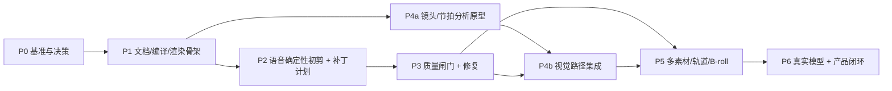

# Pimko 剪辑核心重建计划

> 状态：**已实现（有限制）**（2026-10-29）。依据 [产品意图](../intent.md)、[架构设计](../design/2026-10-29-editing-architecture.md)、[参考实现研究](../research/2026-10-29-reference-implementations.md)。

## 0. 实现进度（2026-10-29）

| 阶段 | 状态 | 已完成 | 未完成 / 风险 |
|---|---|---|---|
| P0 基准 | 完成（人工评分通过） | benchmark/run/score；5/5 stand-in 通过；正式 B1–B5 已跑：B2/B4/B5 ok，B3 warn（0.17s 黑帧），B1 quality pass 但 3 轮模型错误；空时间线全部拒绝 | 人工 1–5 分待填；B4 是合成屏幕占位；B1 需重跑或接受降级结果 |
| P1 文档/编译/渲染 | 完成 | `EditDocument`/`Compiler`/legacy；renderer 吃 `CompiledTimeline`；旧项目可加载 | `timeline` 仍作兼容视图落盘；UI 草稿播放未完全迁移 |
| P2 语音初剪/补丁 | 完成 | `baselinePlan`、`EditPlan`/`applyPlan`、`MockPlanner`；Editor 接入 | 真实模型 ops 在 P6；多素材语义规划有限 |
| P3 质量闸门 | 完成（启发式） | `QualityGate`/`FfmpegInspector`；词边界归一化/吸附、时长/黑帧/字幕检查；导出回执；导出后 GUI 质量横幅；B1/B2/B5 实际 pass，B3 mock pass | 爆音阈值未校准；真实 B3 未在阈值调整后重跑；镜头切断/遮挡部分 skip |
| P4 视觉路径 | 完成（低置信度） | scdet/blackdetect/运动/响度、VisualPlanner、视觉 baseline；无音轨降级 | tutorial 无 OCR；B3/B4 正式基准未跑 |
| P5 多素材/轨道 | **完成（有限制）** | `createDraftFromPaths`、多转写字幕、多素材顺序导出；overlay 轨、`Editor.addBroll`、MCP `add_broll`、GUI「插入 B-roll」、含叠化的 ffmpeg overlay 合成与真实渲染测试 | 只支持全屏 B-roll；多条主视频轨仍只编译第一条；B-roll 音轨不混入；GUI 多素材草稿播放仍看第一段 |
| P6 真实模型 | **完成（有限制）** | `OpenAiPlanner` ops schema、Responses API（讯飞）、429/422/400 json_validate_failed 降级重试、网络瞬断重试、本地校验；真实短链路与讯飞 10/10、6/6、4/4 测试通过 | 免费档 TPM 限流仍可能失败；多轮语义质量/成本未验收 |

合并后验证：`npm run typecheck`、`npm run check:editing`（93 项）、`check:fixtures`（7/7）、`smoke`、`smoke:mcp`、`test:ui`（Xvfb mock E2E）、`npm run build` 均通过；真实短链路（Groq Whisper + planner + 导出 + 质量闸门）通过。正式 B1–B5 成片已跑过；B3 mock 路径在 0.15s 黑帧阈值下已 pass（真实 B3 未重跑），B1 免费档限流仍是已知限制。讯飞 `spark-x2.6` via Responses API 已实测：main 分支 10 轮 10/10 成功，导出质量 pass；4 轮 4/4、6 轮 6/6 也通过。

## 1. 结果

用一条可验证的纵向链路替换当前"LLM 直接吐完整时间线 + 只检查时长/分辨率"的做法：

```text
素材分析 → 确定性初剪 → 受约束补丁计划 → EditDocument
        → 编译时间线 → 渲染 → 切点自检 → 预览/导出
```

完成后，Pimko 能对 4 类固定素材各完成 5 轮真实反馈，并通过 [intent 质量契约](../intent.md#6-质量契约) 的 8 条；至少 2/3 成片达到"愿意直接发布"。

## 2. 计划原则

这不是按层实现的迁移，而是**纵向切片**：

1. **每个阶段都有可运行 demo**：没有"领域层做完了但产品不能用"的阶段。
2. **先立骨架，再换引擎**：P1 先让文档/编译器/渲染器同源，保持现有行为不变；P2 才换剪辑决策。
3. **质量闸门尽早出现**：P3 就检查真实成片的切点，不等到功能做完。
4. **单素材质量达标后再扩多素材**：P5 之前不做多轨/B-roll 的 UI 与渲染。
5. **每阶段有 falsifiable 退出条件**：用真实成片和命令验证，不用"代码写完"当完成。
6. **一次只有一个写入口**：`Editor`；不引入 journal、render graph 或第二套时间线。

## 3. 阶段总览



- **G1（P0 结束）**：确认架构与基准；不确认就不改核心。
- **G2（P3 结束）**：口播切片必须达到 2/3 可发布；否则停止扩内容类型，先修质量。
- **G3（P4b 结束）**：蒙太奇/教程达到各自指标；否则不进多素材。
- **G4（P5 结束）**：多素材不回归单素材质量；否则回退到单素材发布。

## 4. 固定基准

### 4.1 素材

| 编号 | 类型 | 用途 |
|---|---|---|
| B1 | 中文口播 | 词边界、口癖、停顿、字幕 |
| B2 | 英文口播 | 英文词边界、缩写、标点 |
| B3 | 旅行/蒙太奇 | 镜头完整性、节拍、画面连续 |
| B4 | 教程/录屏 | 步骤完整、文字可读、关键操作 |
| B5 | 合成边界 | 切词、爆音、黑帧、字幕遮挡的确定性检查 |

- 清单：`scripts/benchmark/manifest.json`；视频本体放 `.tmp/benchmark/`，不入库。
- 每段素材跑 5 轮反馈：开头收紧、去口癖/废条、按段变速、重排、字幕/配乐。
- 每个阶段都跑同一套基准；新增功能不能只测新素材。

### 4.2 指标

| 指标 | 目标 |
|---|---|
| 切词率（语音切点落在词内部） | 0 |
| 切点爆音数 | 0 |
| 稳定镜头被切断率（蒙太奇/教程） | 0（有意的节奏切除外） |
| 黑帧/冻结帧 | 0 |
| 字幕同步最大误差（有语音时） | < 100ms |
| 输出时长与编译预计误差 | 目标 < 100ms；闸门默认 200ms（逐段帧量化），报告实际值 |
| 渲染成功率 | 100% |
| 质量闸门通过率 | 100% 才允许展示/导出 |
| 主观可发布 | 至少 2/3 成片达到 4/5 |
| 现有回归 | `npm run check:editing` 31 项全过 |

指标按类型解释，不用口播词边界给蒙太奇打分。

## 5. 分阶段执行

### P0 基准与架构确认（约 2 天）

**目标**：知道现在差在哪，确认要改的形状。

- 建 `scripts/benchmark/`：manifest、跑批、评分、对照报告。
- 用当前 Pimko 跑 B1–B4 + 5 轮反馈，保存每版成片、切点表、人工评分。
- 失败分类：切词、爆音、停顿不自然、字幕错位、镜头切断、黑帧/跳变、时长漂移、模型拒绝；按类型分开。
- 评审 [架构设计](../design/2026-10-29-editing-architecture.md) 与本文；确认 `EditDocument`/补丁计划/编译时间线/质量闸门。
- **Demo**：一份可复现的 baseline 报告；同一输入两次运行指标一致。
- **Exit**：G1 通过；没有 baseline 不进入 P1。

### P1 文档/编译/渲染骨架（约 4–5 天）

**目标**：把"唯一文档 + 编译产物 + 渲染器同源"落地，**不改变现有剪辑效果**。

- 新增 `src/domain/document.ts`：`EditDocument`、`EditTrack`、`VideoClip`、`AudioClip`、`SubtitlePolicy`。
- 新增 `src/domain/compiler.ts`：`compile(document, analysis) -> CompiledTimeline`；输出时间映射、转场重叠、字幕投影、时长。
- 新增 `src/domain/legacy.ts`：旧 `Timeline` → `EditDocument`（一条视频轨 + BGM 音轨；旧字幕暂存为迁移用）。
- 改 `Project`：`timeline` → `document` + `analysis`；修订 `schemaVersion: 2`。
- 改 `Renderer`：`render({ compiled, assets, settings, outputPath, mode })`；删除 `render(project)` 路径。
- 改 `PreviewService`、`Editor`、MCP、UI 读取编译产物；旧项目可加载、可导出。
- 现有 `EditPlan` 暂时适配成 `EditDocument`，剪辑行为不变。
- **Demo**：B1 建稿 → 预览 → 导出；旧项目加载；GUI/MCP 得到同一时长与片段。
- **Exit**：31 项回归、fixtures、smoke、smoke:mcp 全过；同一修订的预览/导出时长一致；没有双写。

### P2 语音确定性初剪 + 补丁计划（约 4–5 天）

**目标**：先让口播切点变可靠，再让 LLM 只做语义补丁。

- 新增 `src/domain/analysis.ts` 扩展：`AnalysisBundle`、`AssetAnalysis`、`EditUnit`（word/phrase/shot/beat）。
- 新增 `src/domain/cut-baseline.ts`：响度/静音 label、margin、label→action；词边界吸附 30–200ms。
- 新增 `src/domain/edit-plan.ts`：`EditPlan` + `EditOp`（keep/drop/trim/speed/reorder/transition/setBgm/setSubtitle）；纯校验/apply。
- 改 `src/ports/intelligence.ts` → `Planner`：`propose({ analysis, document, feedback }) -> EditPlan`。
- 改 `src/infra/openai-intelligence.ts`：prompt 使用 packed transcript + 当前文档摘要 + 反馈；只返回 ops。
- 改 `Editor.createDraft/revise`：分析 → first-pass → planner（可选）→ validate/apply → compile → 修订。
- 单测：空计划、非法 UnitId、越界、切词、空时间线、重复、速度边界。
- **Demo**：B1/B2 各 5 轮反馈；每轮显示 diff 与一句说明。
- **Exit**：切词率 0；非法计划 100% 拒绝且保留旧版；31 项回归 + fixtures 全过。

### P3 质量闸门 + 修复（约 4 天）

**目标**：导出前能自动发现坏切点，并有限修复。

- 改 `src/infra/ffmpeg-renderer.ts`：逐段处理（统一尺寸/帧率/编码参数）+ 拼接；每段 30ms 音频淡入/淡出；有语音时字幕最后叠加。
- 新增 `src/services/quality-gate.ts`、`src/ports/inspector.ts`、`src/infra/ffmpeg-inspector.ts`。
- 检查：`wordCut`、`pop`、`blackFrame`、`subtitleOcclusion`、`duration`；蒙太奇相关检查在 P4 接入。
- 新增 `scripts/check-cuts.ts`：任意成片 → JSON + PNG 证据。
- 失败修复：先确定性吸附/补淡化，再 planner 修；最多 3 轮；仍失败阻止导出。
- 修订保存 `quality` 摘要与证据路径；MCP 返回 receipt。
- **Demo**：人为制造切词/爆音/字幕遮挡，闸门能抓到；B1/B2 达到 4/5。
- **Exit**：G2；口播切片 2/3 可发布；不达标不进视觉路径。

### P4 视觉路径：蒙太奇/教程（约 5–6 天）

**目标**：让无语音/弱语音素材也走同一套文档、计划、渲染与质量流程。

- P4a（可与 P2/P3 并行，P1 接口冻结后开始）：新增 `SceneAnalyzer`/`BeatAnalyzer` 原型，输出 shots/beats/blackFrames。
- P4b（P3 后集成）：
  - 新增 `src/ports/visual-analyzer.ts`、`src/infra/ffmpeg-scene-analyzer.ts`。
  - `ContentKind` 判定与 prompt 摘要：镜头列表、节拍、响度、画面变化。
  - 质量检查加 `sceneBreak`、`frozenFrame`；教程的“文字可读”先人工评分，OCR 放后续。
  - 同一 `EditDocument` 支持多镜头；渲染仍是单视频轨。
- **Demo**：B3/B4 各 5 轮反馈；镜头不被切断，节奏与步骤完整。
- **Exit**：G3；B3/B4 至少 2/3 可发布；否则不扩多素材。

### P5 多素材/轨道/B-roll（约 5–6 天）

**目标**：在单素材质量达标后，扩展多素材与轻量叠加。

- 多素材导入、资产库、跨素材单位/镜头选择。
- 渲染器支持多视频轨合成与音频轨混音；文档模型已有多轨，不重写 schema。
- B-roll：先检索/选择，再插入；保持主口播/主叙事完整。
- UI：故事板按素材/轨道分组；MCP 增加素材与轨道工具，但不扩大成 200 工具。
- **Demo**：两段口播 + 一段 B-roll 合成；单素材基准不回归。
- **Exit**：G4；多素材通过质量闸门；单素材指标不退化。

### P6 真实模型 + 产品闭环（约 3–4 天）

**目标**：从"能跑"到"可发布"。

- 真实 OpenAI/Groq/OpenRouter 跑 B1–B4 × 5 轮；记录限流、重试、失败。
- 预览缓存、撤销、diff、receipt、导出进度与取消。
- 性能：预览 draft 与最终导出的耗时；必要时缓存编译产物。
- 文档：更新 `architecture.md` 为重建后的实现；本计划标记 `implemented` 并冻结。
- **Demo**：完整 4 类基准报告 + A/B + 证据目录。
- **Exit**：intent 第 8 节全部通过；至少 2/3 成片 4/5；真实模型失败有可操作错误。

## 6. 并行与资源

| 工作 | 可并行起点 | 约束 |
|---|---|---|
| P4a 镜头/节拍分析原型 | P1 接口冻结后 | 只读分析，不改文档；资源与 P2 错开重负载 |
| UI 故事板/质量报告 | P1 后 | 只消费 `CompiledTimeline`/`QualityReport`，不定义第二套时间线 |
| MCP receipt/查询 | P1 后 | 复用 Editor，不新增旁路 |
| 基准跑批 | P0 后持续 | 渲染/质量检查 CPU 密集，串行执行，避免与 UI E2E 同时跑 |

默认一个主集成者；分析器原型可以并行，但接口、文档 schema、渲染器与质量闸门由同一人集成，避免多写者漂移。

## 7. 文件级工作图

| 文件/目录 | 动作 |
|---|---|
| `src/domain/document.ts` | 新增 `EditDocument`/轨道/片段/字幕策略 |
| `src/domain/analysis.ts` | 扩展 `AnalysisBundle`/`EditUnit`/内容类型 |
| `src/domain/compiler.ts` | 新增纯编译：文档+分析 → `CompiledTimeline` |
| `src/domain/edit-plan.ts` | 新增补丁计划、校验、apply |
| `src/domain/cut-baseline.ts` | 新增确定性 label/margin/action |
| `src/domain/legacy.ts` | 旧 `Timeline` → `EditDocument` |
| `src/domain/document.test.ts` | 文档校验/编译 golden |
| `src/ports/planner.ts` | 替代/扩展 `intelligence.ts` |
| `src/ports/inspector.ts` | 新增渲染检查端口 |
| `src/ports/visual-analyzer.ts` | P4 新增 |
| `src/infra/openai-intelligence.ts` | 改为 ops prompt/schema |
| `src/infra/ffmpeg-renderer.ts` | 改吃 `CompiledTimeline`，逐段渲染/淡化/字幕最后 |
| `src/infra/ffmpeg-inspector.ts` | P3 新增切点/波形/黑帧检查 |
| `src/infra/ffmpeg-scene-analyzer.ts` | P4 新增镜头检测 |
| `src/services/editor.ts` | 接入分析/计划/编译/质量；保持命令层 |
| `src/services/analysis-pipeline.ts` | 新增缓存与并行分析 |
| `src/services/quality-gate.ts` | 新增质量闸门与修复循环 |
| `src/services/preview.ts` | 复用编译产物与缓存键 |
| `src/mcp/server.ts` | receipt/质量状态；不新增旁路 |
| `src/renderer/**` | 故事板、diff、质量证据展示 |
| `scripts/benchmark/*` | 基准 manifest/跑批/评分 |
| `scripts/check-cuts.ts` | 任意成片切点检查 |

## 8. 风险与应对

| 风险 | 应对 |
|---|---|
| 文档/编译器改动破坏旧项目 | P1 只做等价迁移；旧项目加载测试；不双写 |
| LLM 仍越界/切词 | ops 引用 UnitId + 编译器吸附 + 非法回退 first-pass |
| 质量规则误报 | 按内容类型分策略；阈值用基准校准；允许 `warn` |
| 只优化口播，蒙太奇/教程退化 | 4 类基准分开统计；P4 前不扩多素材 |
| 多轨/增量需求提前 | 文档模型已留轨道；渲染与 UI 按 G3/G4 放行 |
| 渲染/自检太慢 | 预览用 draft/子集；最终导出才全量自检；缓存分析/预览 |
| 真实模型限流 | mock 与离线先过；真实失败明确报告；不伪报成功 |
| 范围蔓延 | 本计划不含手动时间线、网页动画、云渲染；新需求先过 intent |

## 9. 完成定义

- P0–P6 全部通过各自 Demo 与 Exit。
- `npm run typecheck`、`check:editing`、`check:fixtures`、`smoke`、`smoke:mcp` 全绿。
- B1–B4 各 5 轮反馈的成片、切点报告、A/B 对照可复现。
- intent 第 6 节 8 条质量契约全部满足；至少 2/3 成片 4/5。
- GUI/MCP 对同一修订得到相同 `CompiledTimeline`、时长、质量报告；质量报告按修订持久化。
- `architecture.md` 已更新为重建后的实现；本计划冻结并标记 `implemented`。

## 10. 需要确认的决策

执行前只确认一件事：**是否接受本设计的三条主线**：

1. `EditDocument` 为唯一真源，`CompiledTimeline` 只派生、不持久化；
2. LLM 只出补丁 `EditPlan`，边界由编译器和确定性分析器决定；
3. 先用 P1–P3 把单素材/口播做到可发布，再在 P4–P5 扩视觉与多素材。

- 接受：从 P0 开始；G1 后进入 P1。
- 不接受：只做 P0（基准与失败报告），不改核心；先拿数据再决定。

## 11. 第一个动作

建立 `scripts/benchmark/`，用当前 Pimko 跑 B1–B4 + 5 轮反馈，产出第一份按内容类型分开的失败报告。没有 baseline，后续任何"变好了"都无法证明。
